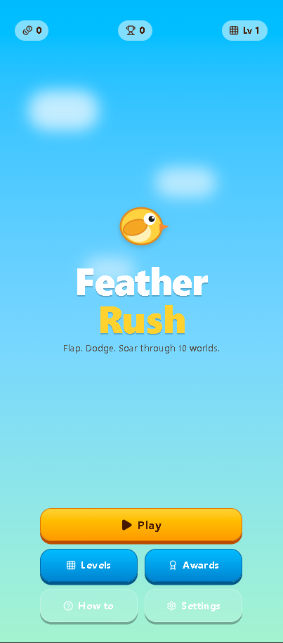
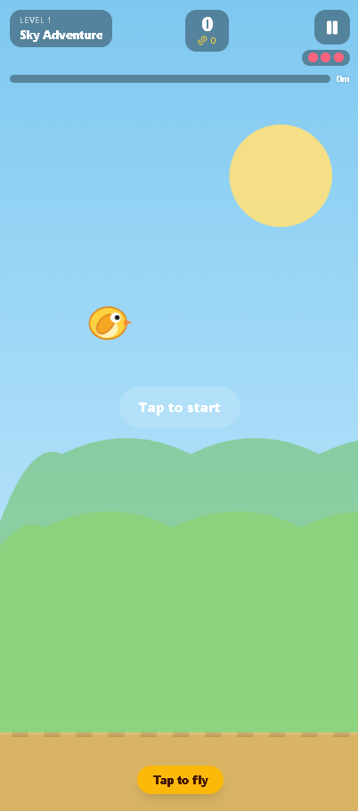
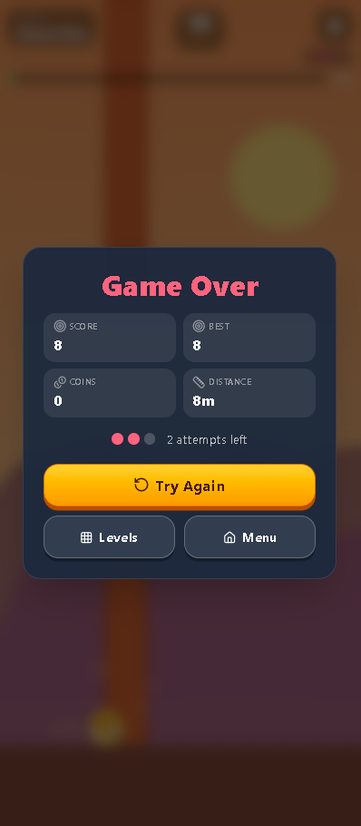

# Feather Rush

Feather Rush is a browser-based arcade flying game inspired by classic endless-runner and flap-style games. Players control a small bird, navigate through obstacles, collect coins, and attempt to achieve the highest possible score while progressing through multiple worlds and levels.

The project demonstrates modern web-based game development using React and Next.js, with a responsive interface designed for both desktop and mobile devices.

---

# Screenshots

## Main Menu



## Gameplay



## Game Over Screen



---

# About The Project

The objective of Feather Rush is simple:

- Tap or click to fly
- Avoid obstacles
- Collect coins
- Travel as far as possible
- Unlock new achievements
- Beat your personal best score

While the controls are easy to learn, the game's increasing speed and obstacle density create a challenging and engaging experience.

---

# Development Process

Feather Rush was developed using an AI-assisted workflow and modern web development tools.

The initial project structure, user interface layouts, and component design were created using **Vercel v0**, an AI-powered UI generation platform. The generated codebase was then exported and further customized locally.

After exporting the project:

- Game screens were refined and connected
- Gameplay mechanics were implemented and adjusted
- User interface elements were customized
- Application configuration was finalized
- The project was tested locally using a Next.js development environment
- Source code was prepared for version control and GitHub publishing

This workflow demonstrates how AI-assisted development tools can accelerate application development while still allowing developers full control over the final implementation.

---

# Technology Stack

## Frontend Framework

- Next.js
- React
- TypeScript

## Styling

- Tailwind CSS
- PostCSS

## Package Management

- pnpm

## Development Tools

- Node.js
- Visual Studio Code
- Git
- GitHub
- Vercel v0

---

# Architecture

The project follows a modern component-based architecture.

## Application Layer

The application is built using the Next.js App Router architecture, providing efficient page rendering and project organization.

## Components

Reusable user interface components are stored within the `components` directory. This improves maintainability and enables consistent design across the application.

## Game Logic

The game implementation includes:

- Flight mechanics
- Collision detection
- Score tracking
- Coin collection
- Distance measurement
- Level progression
- Achievement and reward systems
- State management

## Assets

Static assets such as images and game resources are stored within the `public` directory.

---

# Project Structure

```text
app/
components/
lib/
public/
└── screenshots/

package.json
next.config.mjs
postcss.config.mjs
tsconfig.json
```

---

# Running The Project Locally

## Prerequisites

Install:

- Node.js
- pnpm

Install pnpm globally:

```bash
npm install -g pnpm
```

## Install Dependencies

```bash
pnpm install
```

## Start Development Server

```bash
pnpm dev
```

Open the local URL displayed in the terminal, typically:

```text
http://localhost:3000
```

---

# Production Build

Create an optimized production build:

```bash
pnpm build
```

Run the production server:

```bash
pnpm start
```

---

# Future Improvements

Potential future enhancements include:

- Additional worlds and environments
- New playable characters
- Power-ups and abilities
- Sound effects and music
- Cloud save support
- Online leaderboards
- Daily challenges
- Multiplayer features

---

# License

This project is published for educational, learning, and portfolio purposes.

---

# Acknowledgements

This project was created using:

- Vercel v0 for AI-assisted project generation
- Next.js for the application framework
- React for component-based UI development
- TypeScript for maintainable code
- Tailwind CSS for styling and responsive design